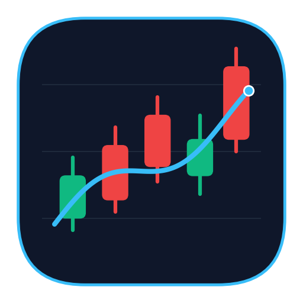

# StockRadar — 台股與主動式 ETF 量化分析工作站

<p align="center">
  
</p>

<p align="center">
  <strong>整合台股技術分析、主動式 ETF 績效檢驗、策略回測與 Discord 訊號雷達的個人量化研究桌面軟體</strong><br>
  支援 <strong>Electron 原生電腦桌面版（macOS / Windows / Linux）</strong> 與 <strong>Streamlit 瀏覽器網頁版</strong> 雙模式執行。
</p>

---

## ✨ 核心功能一覽

| 模組頁面 | 功能亮點 | 對應檔案 |
| :--- | :--- | :--- |
| **📊 個股技術分析** | K 線圖、多週期均線（MA5/10/20/60）、雙布林通道（2σ/3σ）、RSI、MACD、KD 指標、關鍵支撐壓力速覽卡與多空評分 | [`app_pages/overview.py`](app_pages/overview.py) |
| **🔮 AI 股價預測** | 萃取 16 項量價技術指標因子，結合 **多因子嶺迴歸（Ridge Regression）**、**KNN 歷史相似技術型態匹配** 與 **蒙地卡羅信心扇形圖（50%/90% 區間）** 預測未來 1～30 日股價與上漲勝率，並內建 **樣本外滾動驗證（Walk-Forward Validation）** 與全市場潛力排行榜 | [`app_pages/prediction.py`](app_pages/prediction.py) |
| **📡 今日訊號雷達** | 每日收盤全市場掃描（黃金交叉、布林突破、KD 低檔金叉、RSI 超買超賣、爆量長紅），支援一鍵發送 **Discord Rich Embed** 報告 | [`app_pages/screener.py`](app_pages/screener.py) |
| **🔥 主動式 ETF 專區** | 內建台灣主動式 ETF（`00980A`、`00981A`、`00982A`、`00983A`、`00984A`、`00403A`、`00991A`、`00988A`、`00990A`），自動依主題對標 `0050`、`00830`（國泰費城半導體）或 `0056`，計算 **Alpha、Beta、Information Ratio、上漲/下跌捕獲率、相對強弱線（RS Line）** 與 **前十大成分股重疊度矩陣** | [`app_pages/active_etf.py`](app_pages/active_etf.py) |
| **📅 除權息與日曆同步** | 可自由**勾選個股與主動式 ETF 的除權息日與股息發放日**，自動依持倉或自訂股數試算**預估領息金額（NT$）**與**歷史填息天數**，支援 **Google 日曆（Google Calendar）Webhook 一鍵自動寫入**、**單筆免設定直接開啟 Google 日曆新增**、以及 **`.ics` 批次匯入** | [`app_pages/dividends.py`](app_pages/dividends.py) |
| **⚖️ 多股比較與資產配置** | 跨標的正規化累積報酬率、風險報酬散佈圖、相關係數矩陣、滾動波動率，以及 **馬可維茲效率前緣（Markowitz Efficient Frontier）** 蒙地卡羅最適權重模擬（最大夏普 / 最小波動組合） | [`app_pages/comparison.py`](app_pages/comparison.py) |
| **🧪 進階策略回測實驗室** | 內建 6 大量化策略（MA 交叉、RSI、雙布林、MACD、KD、綜合動能），支援 **整張（1,000 股）/ 零股交易模式**、**停損 / 停利 / 移動停損（Trailing Stop）**、**水下回撤圖（Underwater Drawdown）**、**月度報酬熱力圖**、**6 大策略同台 PK 排行榜** 與 **2D 參數網格尋優熱力圖** | [`app_pages/backtest.py`](app_pages/backtest.py) |
| **💼 模擬交易紀錄簿** | 本地端持久化模擬下單帳戶（`paper_portfolio.json`），支援買進 / 賣出、手續費與證交稅模擬、持倉未實現損益追蹤 | [`app_pages/paper_trade.py`](app_pages/paper_trade.py) |
| **🗄️ 資料管理與股票池** | 檢視本地 CSV 完整性、一鍵透過 Yahoo Finance（`yfinance`）補齊最新收盤資料，或輸入任意台股 / ETF 代號新增至追蹤池 | [`app_pages/data_mgmt.py`](app_pages/data_mgmt.py) |

---

## 🖥️ 安裝與執行教學

### 1. 環境需求
- **Python**：`3.10` 以上（建議使用 `.venv` 虛擬環境）
- **Node.js**：`18.0` 以上（用於啟動與打包 Electron 電腦桌面版）

### 2. 初次下載與安裝套件

```bash
# 1. 複製專案到本地端
git clone https://github.com/oscar50513/stock_project.git
cd stock_project

# 2. 建立 Python 虛擬環境並安裝量化分析相依套件
python3 -m venv .venv
source .venv/bin/activate
pip install -r requirements.txt

# 3. 安裝 Electron 桌面端環境
npm install
node node_modules/electron/install.js
```

---

## 🚀 啟動方式

### 方式一：電腦桌面版（推薦，獨立視窗不開瀏覽器）

電腦版採 `Electron + Python` 架構，啟動時會自動在背景挑選空閒 Port 執行量化引擎，並開啟原生桌面視窗；關閉視窗（`Cmd + Q`）時會自動清理背景程序。

#### A. 直接透過腳本或 npm 啟動
```bash
./start.sh
# 或
npm start
```

#### B. 打包成 macOS 原生應用程式（`StockRadar.app`）
若想直接放進 Mac 的「應用程式 (`/Applications`)」或 Dock 雙擊開啟：
```bash
# 打包 macOS arm64 應用程式至 dist/mac-arm64/StockRadar.app
npx electron-builder --mac dir

# 複製到系統「應用程式」資料夾
cp -R dist/mac-arm64/StockRadar.app /Applications/StockRadar.app

# 直接開啟電腦版 App
open /Applications/StockRadar.app
```

#### ⌨️ 電腦版專屬選單與快捷鍵
| 快捷鍵 | 功能說明 |
| :--- | :--- |
| `Cmd / Ctrl + Shift + D` | **立即發送 Discord 收盤訊號報告**（在背景執行 `daily_report.py` 並跳出原生通知視窗） |
| `Cmd / Ctrl + R` | 重新整理當前量化面板 |
| `Cmd / Ctrl + Q` | 結束 StockRadar 並自動關閉背景 Python 引擎 |

---

### 方式二：瀏覽器網頁版（Streamlit Web Mode）

若您希望在一般網頁瀏覽器中使用：
```bash
.venv/bin/streamlit run streamlit_app.py --server.port 8501
```
接著在瀏覽器開啟 `http://localhost:8501` 即可。

---

## 🔔 Discord 收盤訊號自動推播設定

本專案支援透過 **Discord Webhook** 將每日收盤多空評分與技術突破訊號以彩色卡片（Rich Embed）推播至您的個人 Discord 頻道（電腦與手機 App 同步接收通知）。

### 1. 取得 Discord Webhook 網址
1. 在 Discord 建立一個私人伺服器與頻道（例如 `#台股收盤雷達`）。
2. 點擊頻道齒輪 **「編輯頻道」 → 「整合 (Integrations)」 → 「Webhook」 → 「新 Webhook」**。
3. 點擊 **「複製 Webhook 網址」**。

### 2. 設定方式（二擇一）
- **介面設定**：打開 StockRadar 左側選單 **「今日訊號雷達」**，展開「設定 Discord Webhook 自動推播」，貼上網址並點擊 **「儲存並發送測試通知」**。
- **設定檔 `.env`**：在專案根目錄建立 `.env` 檔案（已列入 `.gitignore` 不會上傳至 GitHub）：
  ```env
  DISCORD_WEBHOOK_URL=https://discord.com/api/webhooks/你的Webhook網址
  ```

### 3. 手動或排程執行收盤報告 CLI
您可以隨時在終端機或透過 `crontab` / 系統排程執行 [`daily_report.py`](daily_report.py)：

```bash
# 自動更新最新收盤價 + 掃描訊號 + 推播至 Discord
.venv/bin/python daily_report.py

# 不重新抓股價，強制立即推播目前最新收盤訊號至 Discord
.venv/bin/python daily_report.py --no-update --force

# 僅在終端機預覽報告，不發送通知
.venv/bin/python daily_report.py --no-update --dry-run
```

---

## 📂 專案目錄結構

```text
stock_project/
├── streamlit_app.py          # 量化工作站主入口（多頁面路由）
├── daily_report.py           # 每日收盤自動更新與 Discord 訊號推播 CLI 腳本
├── fill_yfinance_gap.py      # 批次從 Yahoo Finance 補齊所有 CSV 最新收盤價
├── start.sh                  # 一鍵啟動 Electron 電腦桌面版腳本
├── package.json              # Electron 桌面版設定與打包腳本
├── requirements.txt          # Python 相依套件清單
├── electron/                 # 電腦桌面版核心模組
│   ├── main.cjs              # Electron 主程序（自動管理 Python 後端與原生選單）
│   ├── window-state.cjs      # 視窗大小與位置記憶模組
│   ├── splash.html           # 桌面版深色啟動載入畫面
│   └── icon.png              # 應用程式圖示
├── app_pages/                # 7 大功能面板頁面
│   ├── overview.py           # 個股技術分析
│   ├── screener.py           # 今日訊號雷達與 Discord 推播設定
│   ├── active_etf.py         # 主動式 ETF 專區（對標 0050 / 00830 / 0056）
│   ├── comparison.py         # 多股比較與馬可維茲效率前緣配置
│   ├── backtest.py           # 進階策略回測實驗室（6 大策略 + 2D 參數尋優）
│   ├── paper_trade.py        # 模擬交易紀錄簿
│   └── data_mgmt.py          # 資料管理與新增股票代號
├── src/                      # 共用核心模組
│   ├── indicators.py         # 技術指標計算、ETF 元資料與前十大持股資料庫
│   ├── config.py             # 環境變數（.env）讀寫管理
│   └── notifier.py           # Discord Webhook Rich Embed 推播模組
└── *.csv                     # 本地端台股與主動式 ETF 歷史日 K 線資料
```

---

## 🔒 隱私與安全說明
- `.env`（包含您的 Discord Webhook 私密網址）與 `paper_portfolio.json`（個人模擬交易紀錄）皆已加入 [`.gitignore`](.gitignore)，**絕不會被上傳至 GitHub**。
